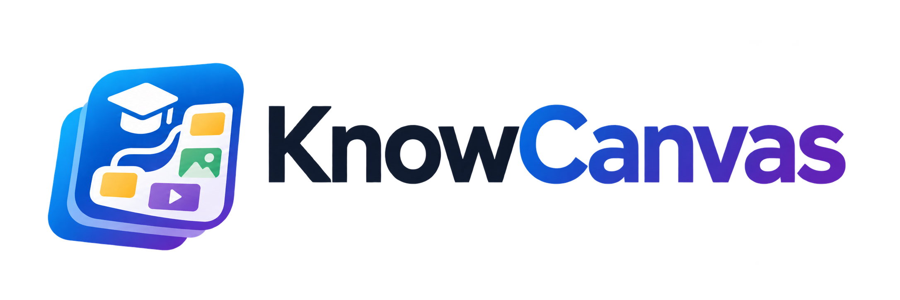

<p align="center">
  
</p>

<p align="center"><strong>Construye experiencias de conocimiento visuales, interactivas y exportables.</strong></p>

KnowCanvas es una herramienta de autoría educativa de código abierto. Combina la libertad de un lienzo espacial con una estructura de libro, widgets semánticos, modo de estudio y publicación web, HTML y SCORM.

> Estado: desarrollo activo. La aplicación es funcional y está publicada, pero todavía no se considera un LMS terminado ni garantiza estabilidad de todos los contratos antes de la versión 1.0.

## Qué permite hacer

- Organizar libros mediante carpetas, páginas y un árbol navegable inspirado en herramientas como Notion.
- Componer cada página sobre un lienzo amplio con selección, movimiento, redimensionado, agrupación y deshacer.
- Crear texto enriquecido, imágenes privadas en Google Drive, tablas, Mermaid, Excalidraw y contenido compuesto.
- Añadir acordeones, pestañas, flashcards, cronologías, imágenes interactivas, test, clasificación, ordenación y relaciones.
- Insertar botones, índices colocables y barras de navegación anterior/siguiente.
- Separar claramente autoría y estudio, con diseños de lectura, revista y presentación.
- Publicar libros públicos o colaborativos y compartir una URL de lectura anónima.
- Descargar HTML autocontenido y paquetes SCORM 1.2.
- Conectar una clave propia de OpenAI para generar propuestas revisables antes de incorporarlas al lienzo.

## Demostración

La instancia de desarrollo está disponible en [knowcanvas.jorge-dieguez.workers.dev](https://knowcanvas.jorge-dieguez.workers.dev).

La disponibilidad de la demostración y sus datos no forma parte de la garantía del proyecto abierto. Para una instalación propia debes configurar Cloudflare, Google OAuth y Google Drive.

## Arquitectura

```text
React + TypeScript
        │
        ├── Editor, estudio y exportadores
        │
Cloudflare Worker ── API, OAuth y autorización
        │
        ├── D1: estructura, contenido y metadatos
        └── Google Drive: archivos privados del usuario
```

El repositorio es un monolito modular TypeScript:

```text
src/client          interfaz React, widgets y exportadores
src/domain          reglas de árbol, composición, estudio y RichText
src/infrastructure  persistencia, recursos e integración OpenAI
src/shared          contratos Zod compartidos
src/worker          API Cloudflare, OAuth y seguridad
migrations          esquema D1 versionado
tests               pruebas unitarias y Playwright
docs                producto, arquitectura, diseño y decisiones
```

Consulta [docs/ARCHITECTURE.md](docs/ARCHITECTURE.md) para los límites y decisiones completas.

## Requisitos

- Node.js 22 o posterior.
- npm compatible con el `package-lock.json`.
- Cuenta de Cloudflare con Workers y D1 para persistencia completa.
- Proyecto OAuth de Google y Drive API para autenticación y archivos.
- Clave de OpenAI opcional y aportada por cada usuario para las funciones de IA.

## Desarrollo local

```bash
git clone https://github.com/jorgedieguez/KnowCanvas.git
cd KnowCanvas
npm install
cp .dev.vars.example .dev.vars
npm run db:migrate
npm run dev
```

Completa `.dev.vars` con tus credenciales locales. El archivo real está excluido de Git.

| Variable                      | Uso                                             |
| ----------------------------- | ----------------------------------------------- |
| `GOOGLE_CLIENT_ID`            | Cliente OAuth web de Google                     |
| `GOOGLE_CLIENT_SECRET`        | Secreto del cliente OAuth                       |
| `GOOGLE_TOKEN_ENCRYPTION_KEY` | Cifrado de refresh tokens de Drive              |
| `USER_SECRET_ENCRYPTION_KEY`  | Cifrado de claves OpenAI aportadas por usuarios |
| `APP_ORIGIN`                  | Origen local o público autorizado               |

Las claves de cifrado deben contener 32 bytes aleatorios codificados como base64url. Nunca uses los valores de ejemplo en producción.

## Google OAuth y Drive

1. Crea un cliente OAuth de tipo aplicación web.
2. Añade `http://127.0.0.1:5173` como origen local autorizado.
3. Añade `http://127.0.0.1:5173/api/auth/google/callback` como redirección local.
4. Habilita Google Drive API.
5. Configura en la pantalla de consentimiento los ámbitos OpenID y `drive.file`.
6. Para producción, añade el dominio y callback de tu propia instalación.

KnowCanvas solo solicita acceso a los archivos de Drive creados o seleccionados mediante la aplicación. Los tokens se cifran antes de persistirse.

## Base de datos

Para desarrollo local:

```bash
npm run db:migrate
```

Para una instalación Cloudflare crea tu propia D1, sustituye el `database_id` de `wrangler.jsonc` y aplica las migraciones:

```bash
npx wrangler d1 create knowcanvas-db
npx wrangler d1 migrations apply knowcanvas-db --remote
```

El identificador incluido en este repositorio corresponde a la instancia de demostración y no concede acceso a ella.

## Comprobaciones

```bash
npm run check       # formato, lint, tipos, unidad y build
npm run test:e2e    # flujos de interfaz en escritorio y móvil
npm run preview     # build y preview con runtime Workers
```

La primera ejecución E2E puede requerir:

```bash
npx playwright install chromium
```

## Despliegue

Configura tus secretos con Wrangler y publica:

```bash
npx wrangler secret put GOOGLE_CLIENT_SECRET
npx wrangler secret put GOOGLE_TOKEN_ENCRYPTION_KEY
npx wrangler secret put USER_SECRET_ENCRYPTION_KEY
npm run deploy
```

No uses el despliegue de demostración como backend de un fork.

## Documentación

- [Producto y alcance](docs/PRD.md)
- [Arquitectura](docs/ARCHITECTURE.md)
- [Sistema de diseño](docs/DESIGN.md)
- [Reglas técnicas](docs/RULES.md)
- [Identidad de marca](docs/brand-guidelines.md)

## Contribuir

Las aportaciones son bienvenidas. Lee [CONTRIBUTING.md](CONTRIBUTING.md), abre primero una incidencia para cambios estructurales y ejecuta `npm run check` antes de enviar una pull request.

Las vulnerabilidades deben comunicarse mediante [SECURITY.md](SECURITY.md), nunca en una incidencia pública.

## Licencia y marca

El código se distribuye bajo [Apache License 2.0](LICENSE). Puedes usarlo, modificarlo y redistribuirlo respetando sus condiciones.

La licencia de código no concede derechos sobre el nombre, logotipo o identidad visual de KnowCanvas salvo para atribución razonable y para describir el origen del software. Consulta [NOTICE](NOTICE) y [THIRD_PARTY_NOTICES.md](THIRD_PARTY_NOTICES.md).
